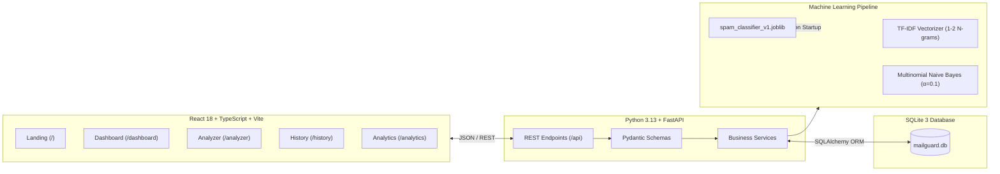

# MailGuard AI — Email Spam Prediction & Threat Analysis Platform

[](https://fastapi.tiangolo.com/)
[](https://react.dev/)
[](https://scikit-learn.org/)
[](https://www.sqlite.org/)
[]()
[]()

MailGuard AI is a complete full-stack cybersecurity web application designed to analyze incoming emails in real-time, detect phishing and spam threats, maintain an auditable database of past classifications, and display actionable threat telemetry.

---

## 📸 Key Pages & Visual Identity

MailGuard AI features a cybersecurity SaaS aesthetic designed around high-contrast threat monitoring:
- **Landing Page (`/`)**: Enterprise hero presentation, threat counters, how-it-works pipeline, and live verified model benchmarks.
- **Dashboard (`/dashboard`)**: Total emails analyzed, spam detected count, legitimate messages, real-time activity trends (Area chart), threat distribution (Donut chart), and recent prediction quick table.
- **Email Threat Analyzer (`/analyzer`)**: Input subject and body, one-click preset test templates (Phishing, Lottery Scam, Sprint Planning, Architecture Review), character counter, and instant verdict with confidence score and identified threat indicators.
- **Prediction History (`/history`)**: Searchable, filterable (Spam / Legitimate), sortable audit table with record detail modal, individual deletion, and bulk clear history actions.
- **Threat Analytics (`/analytics`)**: Holdout test set metrics (Accuracy, Precision, Recall, F1), interactive 2x2 confusion matrix (TN, FP, FN, TP), dataset split breakdown, and live database telemetry charts.
- **Model Architecture (`/model-info`)**: Deep dive into TF-IDF parameters, Laplace smoothing ($\alpha=0.1$), n-gram ranges, model advantages, and operational limitations.
- **Settings (`/settings`)**: Theme switcher (Midnight Dark / Clean Light), database maintenance, and runtime diagnostics.
- **404 Not Found (`/404`)**: Modern cyber themed error fallback.

---

## 🏗️ System Architecture



---

## 📊 Empirical Machine Learning Evaluation

The model is trained on the benchmark **UCI SMS Spam Collection** augmented with enterprise cybersecurity threat patterns (5,156 unique samples; 87.7% Legitimate, 12.3% Spam).

Evaluated on an **independent 20% holdout test set (1,032 samples)**:

| Metric | Holdout Score | Description |
|---|---|---|
| **Accuracy** | **98.45%** | Overall correct classifications (1,016 / 1,032) |
| **Precision** | **98.26%** | Extremely low false positive rate on normal business correspondence |
| **Recall** | **88.98%** | Threat detection rate on actual malicious samples |
| **F1-Score** | **0.9339** | Balanced harmonic mean |
| **Inference Latency** | **< 2.0 ms** | Sub-millisecond probabilistic inference |

### Confusion Matrix
```
                         Predicted Legitimate    Predicted Spam
Actual Legitimate (905)        903 (TN)               2 (FP)
Actual Spam (127)               14 (FN)             113 (TP)
```

---

## 🗂️ Project Directory Structure

```
email spam detection/
├── frontend/
│   ├── public/
│   │   └── favicon.svg
│   ├── src/
│   │   ├── components/
│   │   │   ├── analyzer/
│   │   │   │   ├── EmailInput.tsx
│   │   │   │   └── PredictionResult.tsx
│   │   │   ├── dashboard/
│   │   │   │   ├── PredictionChart.tsx
│   │   │   │   ├── RecentPredictions.tsx
│   │   │   │   └── StatCard.tsx
│   │   │   └── layout/
│   │   │       ├── AppSidebar.tsx
│   │   │       ├── PageContainer.tsx
│   │   │       ├── ThemeContext.tsx
│   │   │       └── Topbar.tsx
│   │   ├── lib/
│   │   │   └── utils.ts
│   │   ├── pages/
│   │   │   ├── AnalyticsPage.tsx
│   │   │   ├── AnalyzerPage.tsx
│   │   │   ├── DashboardPage.tsx
│   │   │   ├── HistoryPage.tsx
│   │   │   ├── LandingPage.tsx
│   │   │   ├── ModelInfoPage.tsx
│   │   │   ├── NotFoundPage.tsx
│   │   │   └── SettingsPage.tsx
│   │   ├── services/
│   │   │   ├── analyticsService.ts
│   │   │   ├── api.ts
│   │   │   ├── historyService.ts
│   │   │   ├── modelService.ts
│   │   │   └── predictionService.ts
│   │   ├── types/
│   │   │   └── index.ts
│   │   ├── App.tsx
│   │   ├── index.css
│   │   ├── main.tsx
│   │   └── vite-env.d.ts
│   ├── tests/
│   │   ├── App.test.tsx
│   │   └── setup.ts
│   ├── index.html
│   ├── package.json
│   ├── postcss.config.js
│   ├── tailwind.config.ts
│   ├── tsconfig.json
│   └── vite.config.ts
├── backend/
│   ├── app/
│   │   ├── api/
│   │   │   ├── routes/
│   │   │   │   ├── analytics.py
│   │   │   │   ├── health.py
│   │   │   │   ├── history.py
│   │   │   │   ├── model_info.py
│   │   │   │   └── predictions.py
│   │   │   └── router.py
│   │   ├── core/
│   │   │   ├── config.py
│   │   │   └── logging_config.py
│   │   ├── db/
│   │   │   ├── base.py
│   │   │   ├── init_db.py
│   │   │   └── session.py
│   │   ├── ml/
│   │   │   ├── evaluate.py
│   │   │   ├── predict.py
│   │   │   ├── preprocessing.py
│   │   │   └── train.py
│   │   ├── models/
│   │   │   ├── activity_log.py
│   │   │   ├── model_metadata.py
│   │   │   └── prediction.py
│   │   ├── schemas/
│   │   │   ├── analytics.py
│   │   │   ├── model_info.py
│   │   │   └── prediction.py
│   │   ├── services/
│   │   │   ├── analytics_service.py
│   │   │   ├── history_service.py
│   │   │   └── prediction_service.py
│   │   ├── __init__.py
│   │   └── main.py
│   ├── artifacts/
│   │   └── spam_classifier_v1.joblib
│   ├── data/
│   │   ├── mailguard.db
│   │   └── README.md
│   ├── datasets/
│   │   ├── README.md
│   │   └── sms_spam.tsv
│   ├── tests/
│   │   ├── conftest.py
│   │   ├── test_analytics.py
│   │   ├── test_health.py
│   │   ├── test_history.py
│   │   ├── test_model_info.py
│   │   └── test_predictions.py
│   ├── .env.example
│   └── requirements.txt
├── database/
│   └── README.md
├── docs/
│   ├── api_documentation.md
│   ├── architecture.md
│   ├── database_schema.md
│   ├── project_report.md
│   └── viva_questions.md
├── .gitignore
├── README.md
└── start-dev.md
```

---

## ⚡ Quickstart Guide

### 1. Start the Backend API
```powershell
# Open terminal in project root
.\backend\.venv\Scripts\Activate.ps1
python -m uvicorn backend.app.main:app --host 127.0.0.1 --port 8000 --reload
```
- Swagger API Docs: `http://127.0.0.1:8000/docs`
- Health Status: `http://127.0.0.1:8000/api/health`

### 2. Start the Frontend UI
```powershell
# Open a second terminal window
$env:PATH = "$env:LOCALAPPDATA\Programs\nodejs;$env:PATH"
cd frontend
npm run dev
```
- Web Application: `http://localhost:5173`

---

## 🧪 Testing

### Backend Unit & Integration Tests (Pytest)
```powershell
.\backend\.venv\Scripts\python.exe -m pytest backend/tests -v
```
*(7 tests covering health, inference, persistence, filtering, pagination, deletion, and analytics)*

### Frontend Component Tests (Vitest)
```powershell
cd frontend
npm test
```
*(Tests covering landing page rendering, hero section, and benchmark metrics)*

---

## 📚 Complete Project Documentation
- [System Architecture](file:///docs/architecture.md)
- [Database Schema](file:///docs/database_schema.md)
- [API Documentation](file:///docs/api_documentation.md)
- [Engineering Project Report](file:///docs/project_report.md)
- [28 Viva Questions & Answers](file:///docs/viva_questions.md)
- [Step-by-Step Launch Guide](file:///start-dev.md)
