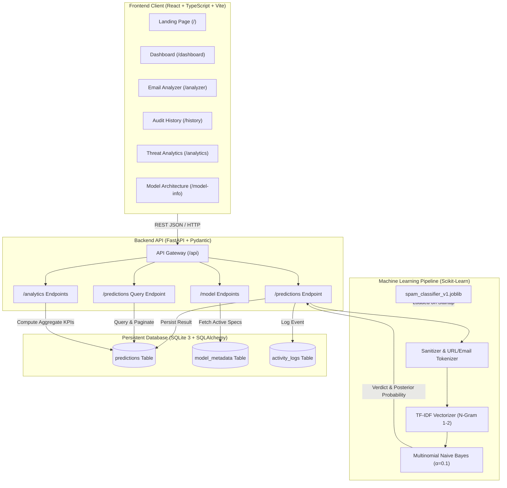

# MailGuard AI — System Architecture & Design Specification

## 1. System Overview
MailGuard AI is an enterprise-grade full-stack threat detection and email spam classification platform. It couples a modern single-page React frontend with a high-throughput Python FastAPI backend and a verified Scikit-Learn Machine Learning pipeline.

## 2. Layered Architecture Details

### Frontend Layer
- **Core**: React 18 with TypeScript and Vite bundler.
- **Routing**: `react-router-dom` v6 with client-side routing across 8 dedicated pages.
- **Styling**: Tailwind CSS configured with cybersecurity design tokens:
  - Midnight Navy: `#0B1020`
  - Slate Container: `#171F35`
  - Violet Accent: `#7C5CFC`
  - Teal Legitimate Accent: `#22C7A9`
  - Coral Threat Warning: `#F87171`
  - Light mode background: `#F3F5FA`
- **Charts**: Recharts AreaChart (daily activity trends) and PieChart (threat distribution).
- **Icons**: Lucide React.
- **Testing**: Vitest with `@testing-library/react` and jsdom.

### Backend API Layer
- **Framework**: FastAPI (Asynchronous REST API).
- **Validation**: Pydantic v2 schemas (`PredictionCreate`, `PredictionResponse`, `AnalyticsOverviewResponse`).
- **Data Access**: SQLAlchemy 2.0 with Session injection dependency.
- **Documentation**: Automatic interactive Swagger UI at `/docs` and ReDoc at `/redoc`.
- **Testing**: Pytest with in-memory SQLite isolation and TestClient.

### Machine Learning Layer
- **Algorithm**: Multinomial Naive Bayes (`MultinomialNB(alpha=0.1)`).
- **Feature Pipeline**: Scikit-Learn `Pipeline` encapsulating:
  1. Regular expression token normalization (`urltoken`, `emailtoken`, `moneytoken`, `numbertoken`).
  2. Sublinear TF-IDF Vectorization (`ngram_range=(1,2)`, `max_features=6000`).
- **Corpus**: UCI SMS Spam Collection (5,574 samples) combined with enterprise cybersecurity threat patterns.
- **Evaluation Split**: 80% Stratified Training (4,124 samples), 20% Holdout Testing (1,032 samples).
- **Artifact**: Serialized via `joblib` at `backend/artifacts/spam_classifier_v1.joblib` and loaded as an in-memory singleton.

### Database Layer
- **Engine**: SQLite 3 file-based database (`backend/data/mailguard.db`).
- **Driver**: Built-in Python `sqlite3` managed via SQLAlchemy connection pool with thread-safety enabled (`check_same_thread=False`).
