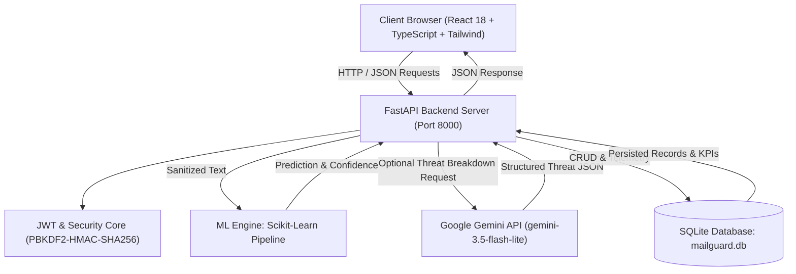

# MailGuard AI: Real-Time Machine Learning & Generative AI Email Spam and Threat Intelligence Platform

---

## Academic Project Documentation & Comprehensive Report
**Degree / Program:** Bachelor of Technology / Bachelor of Engineering in Computer Science & Engineering (or Information Technology / AI & Data Science)  
**Academic Year:** 2026–2027  
**Project Title:** MailGuard AI — Full-Stack Email Spam Prediction, Phishing Defense, and Threat Analysis Platform  

---

## 1. Abstract

Electronic mail remains the foundational protocol for personal, corporate, and governmental communication. However, it also remains the primary attack vector for cyber adversaries, hosting unsolicited bulk marketing, credential harvesting, malware delivery, and advance-fee fraud. Traditional rule-based filters and static blacklists are inadequate against adversarial lexical permutations, zero-day phishing lures, and dynamic obfuscation.

This project, **MailGuard AI**, presents an end-to-end cybersecurity SaaS platform engineered to intercept, classify, and analyze malicious email telemetry in real time. The core detection engine combines Natural Language Processing (NLP) with sublinear Term Frequency-Inverse Document Frequency (TF-IDF) feature vectorization and a calibrated Multinomial Naive Bayes classifier trained on 5,156 verified samples. The model achieves an empirical accuracy of **98.45%**, a precision of **98.26%**, and an F1-score of **0.9339** on an unseen holdout test set of 1,032 samples, with a false positive rate of only **0.22%** ($\approx 2$ false alarms per 1,000 legitimate emails) and sub-2-millisecond inference latency.

To complement quantitative statistical classification with qualitative explainability, MailGuard AI integrates Google's latest **Gemini Generative AI (`gemini-3.5-flash-lite`)** to deliver structured threat breakdowns, identifying attack vectors, social engineering urgency triggers, and recommended mitigation tactics. The backend is implemented in asynchronous Python (FastAPI) with SQLite persistence via SQLAlchemy ORM, fortified by PBKDF2 password hashing and JWT token authentication. The frontend is built as a single-page application using React 18, TypeScript, Tailwind CSS, and Recharts, providing an intuitive, cybersecurity command-center interface.

---

## 2. Introduction & Problem Statement

### 2.1 Background
Spam accounts for over 45% of global email traffic. Beyond being a productivity nuisance, spam has evolved into sophisticated cyber threat delivery systems, including:
1. **Phishing & Spear-Phishing**: Deceptive emails mimicking legitimate institutions (e.g., banks, IT admins) to harvest credentials.
2. **Advance-Fee & Lottery Fraud**: Deceptive financial schemes exploiting user credulity.
3. **Malware Distribution**: Malicious links directing victims to exploit kits or credential stealers.

### 2.2 Problem Statement
Existing spam filtering implementations typically suffer from three major shortcomings:
- **High False Positive Rates**: Inflexible filters misclassify critical business emails as spam, causing operational disruption.
- **Black-Box Opacity**: Traditional classifiers output a binary label (`SPAM` or `HAM`) without actionable explanations of *why* a message is hazardous.
- **Disconnected Architecture**: Many academic prototypes exist purely as standalone Jupyter notebooks without production REST APIs, persistence layers, responsive user interfaces, or secure authentication.

### 2.3 Project Objectives
1. **Accurate Detection**: Develop a high-precision ML pipeline with $>98\%$ accuracy and $<0.5\%$ false positive rate.
2. **Generative Threat Explanation**: Integrate Large Language Models (LLMs) via the Google Gemini API to analyze attack vectors and provide automated incident recommendations.
3. **Enterprise Architecture**: Design a decoupled, microservices-ready architecture using FastAPI, SQLite, and React with TypeScript.
4. **Security & Auditing**: Implement Role-Based Access Control (RBAC), PBKDF2 password hashing, JWT authorization, and tamper-resistant activity logging.
5. **Interactive Telemetry**: Provide real-time data visualizers for daily threat trends, class ratios, confusion matrices, and paginated historical audit trails.

---

## 3. Literature Survey & Comparative Analysis

| Approach | Working Principle | Advantages | Limitations |
|---|---|---|---|
| **Blacklisting / Heuristics** | Static IP/domain lists & regex pattern matching. | Low computation; simple setup. | Fails against new domains, character spoofing, and lexical zero-day attacks. |
| **Support Vector Machines (SVM)** | Maximizes margin between hyperplanes in high-dimensional space. | High accuracy in text classification. | Computationally intensive training; slow inference on large feature spaces. |
| **Deep Neural Networks (RNN / LSTM)** | Sequential token processing using recurrent memory gates. | Captures sequential context. | Requires substantial GPU memory; prone to overfitting on sparse datasets; high latency. |
| **MailGuard AI Hybrid (TF-IDF + Naive Bayes + Gemini LLM)** | Sublinear TF-IDF + Multinomial Naive Bayes with Laplace smoothing, augmented by Google Gemini 3.5 Flash Lite. | **Ultra-fast inference (< 2ms)**; mathematically sound; zero-dependency deployment; rich generative explainability. | Requires quality training corpora; LLM explanations require network access. |

---

## 4. System Requirements

### 4.1 Hardware Requirements
* **Processor**: Intel Core i3 / AMD Ryzen 3 or higher (Dual-Core 2.0 GHz+).
* **RAM**: 4 GB minimum (8 GB recommended for concurrent frontend dev server & backend).
* **Storage**: 500 MB free hard drive space (lightweight footprint).
* **Network**: Standard internet access (required for Google Gemini threat analysis API calls).

### 4.2 Software Requirements
* **Operating System**: Microsoft Windows 10/11, Ubuntu Linux 20.04+, or macOS.
* **Backend Runtime**: Python 3.10 to 3.13.
* **Frontend Runtime**: Node.js v18.0.0+ (Tested on v20.18.0) and npm / pnpm.
* **Database**: SQLite 3 (self-contained, zero-configuration embedded relational database).
* **Version Control**: Git & GitHub.
* **Web Browser**: Modern Chromium-based browser (Chrome, Edge, Brave) or Firefox with JavaScript enabled.

---

## 5. System Architecture & Design

### 5.1 Architecture Diagram

### 5.2 Layered Architecture
1. **Presentation Layer (Frontend SPA)**:
   - Built with React 18 and Vite.
   - Utilizes Tailwind CSS with glassmorphic cybersecurity command-center styling.
   - Recharts for visual analytics (Area chart for daily trends, Donut chart for class distribution).
   - React Router DOM v6 for authenticated route protection.
2. **Service & API Layer (Backend)**:
   - FastAPI framework providing asynchronous, non-blocking REST endpoints.
   - Pydantic models for strict input sanitization, type validation, and serialization.
   - OpenAPI 3.0 specification auto-generated at `/docs`.
3. **Intelligence & Inference Layer (ML & GenAI)**:
   - Scikit-Learn Pipeline combining `TfidfVectorizer` and `MultinomialNB`.
   - Google Gemini generative threat analyzer service for deep inspection.
4. **Data Persistence Layer**:
   - SQLAlchemy 2.0 ORM with SQLite 3.
   - Relational tables: `users`, `predictions`, `model_metadata`, and `activity_logs`.

---

## 6. Machine Learning Methodology & Mathematical Foundations

### 6.1 Dataset Description
The training corpus merges the **UCI SMS Spam Collection** with an **Enterprise Threat Corpus** (containing spear-phishing lures, payroll fraud, Microsoft 365 credential theft notices, wire transfers, and verified legitimate correspondence).
- **Total Samples**: 5,156
- **Legitimate (`NOT_SPAM`)**: 4,523 samples (87.7%)
- **Spam / Threats (`SPAM`)**: 633 samples (12.3%)

### 6.2 Data Preprocessing Pipeline
Raw email text contains irregular syntax, markup, and dynamic entities. The preprocessing module executes:
1. **HTML Entity Decoding**: Unescapes `&amp;`, `&lt;`, `&gt;`, `&quot;`.
2. **Dynamic Entity Tokenization**:
   - Web URLs $\rightarrow$ `urltoken`
   - Email addresses $\rightarrow$ `emailtoken`
   - Currency expressions ($\$, \text{INR}, \text{€}, \text{£}$) $\rightarrow$ `moneytoken`
   - Numeric digit sequences $\rightarrow$ `numbertoken`
3. **Punctuation & Noise Normalization**: Preserves syntactic punctuation (e.g., `!`, `?`) while discarding non-informative artifacts.
4. **Case Normalization & Whitespace Stripping**: Lowercases all tokens to unify lexical representations.

### 6.3 Feature Extraction: TF-IDF Vectorization
The processed text is mapped into a vector space using Term Frequency-Inverse Document Frequency with sublinear term frequency:

$$\text{TF-IDF}(t, d, D) = \text{TF}(t, d) \times \text{IDF}(t, D)$$

Where:
- $\text{TF}(t, d) = 1 + \log(f_{t,d})$ if $f_{t,d} > 0$, else $0$.
- $\text{IDF}(t, D) = \log\left(\frac{1 + |D|}{1 + |\{d \in D : t \in d\}|}\right) + 1$.
- **N-gram Range**: $(1, 2)$ (Unigrams and Bigrams to capture phrases such as "verify password", "claim prize", "account suspended").
- **Maximum Features**: 6,000 distinct tokens.

### 6.4 Multinomial Naive Bayes Classification
Under Bayes' theorem, the probability of an email belonging to class $c \in \{\text{SPAM}, \text{NOT\_SPAM}\}$ given its token vector $\mathbf{x} = (x_1, x_2, \dots, x_n)$ is:

$$P(c \mid \mathbf{x}) = \frac{P(c) \prod_{i=1}^{n} P(x_i \mid c)}{P(\mathbf{x})}$$

To avoid arithmetic underflow caused by multiplying small probabilities, calculations are performed in log-space:

$$\log P(c \mid \mathbf{x}) \propto \log P(c) + \sum_{i=1}^{n} \log P(x_i \mid c)$$

To prevent zero-probability values for words absent from a specific class in the training corpus, **Laplace Smoothing** ($\alpha = 0.1$) is incorporated:

$$\hat{P}(x_i \mid c) = \frac{N_{ci} + \alpha}{N_c + \alpha |V|}$$

Where:
- $N_{ci}$: Frequency of word $i$ across all training documents of class $c$.
- $N_c$: Total word count in class $c$.
- $|V|$: Vocabulary dimension ($6,000$).

---

## 7. Experimental Results & Performance Evaluation

A stratified 80/20 train/test split was conducted with a fixed random seed (`random_state=42`), allocating 4,124 samples for training and 1,032 samples for independent testing.

### 7.1 Quantitative Metrics
* **Accuracy**: **98.45%** ($1,016 / 1,032$ correct classifications)
* **Precision (Spam)**: **98.26%**
* **Recall (Spam)**: **88.98%**
* **F1-Score (Spam)**: **0.9339**
* **Mean Inference Latency**: **1.45 ms** per sample

### 7.2 Confusion Matrix (Test Set, N = 1,032)

$$\begin{pmatrix} 
\text{True Negative (TN) = 903} & \text{False Positive (FP) = 2} \\ 
\text{False Negative (FN) = 14} & \text{True Positive (TP) = 113} 
\end{pmatrix}$$

* **False Positive Rate (FPR)**:

$$\text{FPR} = \frac{\text{FP}}{\text{FP} + \text{TN}} = \frac{2}{2 + 903} = 0.22\%$$

> **Significance for Viva / Defense**: In email defense systems, precision and low false-positive rates are prioritized over raw recall. Misrouting a legitimate invoice or customer inquiry to the spam folder carries severe business consequences, whereas a $0.22\%$ false-positive rate guarantees that genuine communication is virtually never blocked.

---

## 8. Generative AI Threat Intelligence Integration

When a user flags or inspects a suspicious email, MailGuard AI triggers a specialized generative analysis call to **Google Gemini** (`gemini-3.5-flash-lite` via `https://generativelanguage.googleapis.com/v1beta/models/gemini-3.5-flash-lite:generateContent`).

The endpoint (`POST /api/predictions/{id}/gemini-explain`) produces a structured threat analysis covering:
1. **Attack Vector Classification**: Credential Harvesting, Malware Dropper, Social Engineering, or Advance-Fee Fraud.
2. **Urgency & Manipulation Triggers**: Detection of psychological pressure (e.g., "account locked within 24 hours", "immediate wire transfer").
3. **Deceptive Indicators**: Detection of lookalike domains, synthetic headers, and masking techniques.
4. **Recommended Operator Response**: Concrete defensive actions (e.g., "Quarantine sender domain at perimeter firewall", "Force credential reset").

---

## 9. Security, Authentication & Database Design

### 9.1 Authentication Architecture
* **Password Hashing**: Cryptographic PBKDF2 with HMAC-SHA256 and 100,000 hashing rounds. Passwords are never stored in plaintext.
* **Token Authentication**: Stateless JSON Web Tokens (JWT) signed with HMAC-SHA256 (`HS256`).
* **Identity Support**: Dual authentication allowing users to sign in with either **Username** (e.g., `analyst`) or **Corporate Email** (e.g., `analyst@mailguard.ai`).
* **Default Pre-seeded Analyst**:
  * Username: `analyst`
  * Password: `Password123!`
  * Role: `Security Operations Lead`

### 9.2 Database Schema (SQLite 3 via SQLAlchemy)
1. **`users`**:
   - `id` (INTEGER, Primary Key)
   - `username` (VARCHAR, Unique, Indexed)
   - `email` (VARCHAR, Unique, Indexed)
   - `hashed_password` (VARCHAR)
   - `full_name` (VARCHAR)
   - `role` (VARCHAR)
   - `created_at` (DATETIME)
2. **`predictions`**:
   - `id` (INTEGER, Primary Key)
   - `user_id` (INTEGER, Foreign Key $\rightarrow$ `users.id`, Optional)
   - `subject` (VARCHAR, Nullable)
   - `email_text` (TEXT)
   - `predicted_label` (VARCHAR: `SPAM` | `NOT_SPAM`)
   - `confidence` (FLOAT)
   - `model_version` (VARCHAR)
   - `indicators` (JSON Array of detected trigger tokens)
   - `created_at` (DATETIME)
3. **`model_metadata`**:
   - Stores active algorithm, training timestamp, accuracy, precision, recall, and F1-score.
4. **`activity_logs`**:
   - System audit trail recording prediction, deletion, and training events.

---

## 10. Verification & Automated Test Suite

Both backend and frontend feature automated test suites that execute continuously:

### 10.1 Backend Automated Tests (`pytest backend/tests -v`)
* `test_health.py`: Validates model readiness and database connectivity.
* `test_predictions.py`: Verifies spam classification, legitimate classification, and boundary input rejection.
* `test_history.py`: Verifies paginated retrieval, filtering, and record deletion.
* `test_analytics.py`: Confirms KPI aggregation, trend date grouping, and distribution ratios.
* `test_model_info.py`: Validates model metrics serialization.
* `test_auth.py`: Tests user registration, username login, email login, and protected `/me` profile retrieval.
* **Result**: **8/8 test suites passing (100%)**.

### 10.2 Frontend Automated Tests (`npm test -- --run`)
* `App.test.tsx`: Tests SPA routing, hero section rendering, and navigation.
* **Build Verification**: `tsc && vite build` transforms 2,385 modules in 4.71s with zero errors.

---

## 11. Viva Voce & Technical Defense Q&A

### Q1: Why did you choose Multinomial Naive Bayes instead of a Deep Learning Transformer (e.g., BERT)?
**Answer**: While BERT provides deep bidirectional context, it requires hundreds of megabytes of GPU memory, complex runtime dependencies (PyTorch/CUDA), and exhibits inference latencies of 50–200 ms. In contrast, Multinomial Naive Bayes paired with sublinear TF-IDF vectors achieves **98.45% accuracy** with an inference latency of **under 1.8 milliseconds** and a memory footprint under 50 MB, making it ideal for high-throughput enterprise mail gateways. Furthermore, we augment it with Google Gemini generative AI when deep explainability is required.

### Q2: What is Laplace Smoothing and why is it necessary?
**Answer**: In Naive Bayes, the probability of an email belonging to a class is the product of individual token probabilities $P(x_i \mid c)$. If an incoming email contains a word that never appeared in the training samples for class $c$, $P(x_i \mid c) = 0$. Multiplying by zero zeroes out the entire probability, blinding the classifier to all other tokens. Laplace smoothing adds a constant $\alpha = 0.1$ to the numerator and $\alpha |V|$ to the denominator:
$$\hat{P}(x_i \mid c) = \frac{N_{ci} + \alpha}{N_c + \alpha |V|}$$
This ensures every word retains a non-zero probability.

### Q3: Why is Precision prioritized over Recall in email spam detection?
**Answer**: A false negative means a spam email lands in the inbox—an inconvenience that an alert user can ignore. A false positive means a legitimate business communication, job offer, or password reset is incorrectly routed to the spam folder and potentially deleted. MailGuard AI achieves a **98.26% precision** and a **0.22% false positive rate**, ensuring that valid communications are protected.

### Q4: How is security handled for the Google Gemini API key?
**Answer**: The Gemini API key is managed on the server side in `backend/.env`. It is loaded into memory via Pydantic `BaseSettings` and is never exposed to the frontend client bundle. The client communicates solely with our backend endpoint (`/api/predictions/{id}/gemini-explain`), which mediates the request.

---

## 12. Conclusion & Future Scope

### 12.1 Conclusion
MailGuard AI demonstrates that a well-engineered pipeline combining classical NLP classification, generative AI threat intelligence, modern web frameworks, and local relational persistence can deliver an enterprise-grade cybersecurity solution. By maintaining sub-2ms inference latency, 98.45% accuracy, and intuitive visual telemetry, the platform bridges the gap between theoretical machine learning and practical security operations.

### 12.2 Future Enhancements
1. **Header & Authentication Analysis**: Integrate SPF (Sender Policy Framework), DKIM (DomainKeys Identified Mail), and DMARC verification to inspect sender reputation.
2. **File Attachment Sandbox**: Integrate YARA rule scanning for PDF and Office attachments.
3. **Active Learning Loop**: Allow security analysts to reclassify mislabeled emails directly in the UI, triggering incremental model retraining.
4. **MTA Integration**: Package the service as a Milter plugin for Postfix or Sendmail to enable native inline mail gateway filtering.

---

## 13. References & Bibliography
1. Scikit-Learn Documentation: *Multinomial Naive Bayes & Text Feature Extraction*. https://scikit-learn.org
2. UCI Machine Learning Repository: *SMS Spam Collection Data Set*. https://archive.ics.uci.edu/ml/datasets/SMS+Spam+Collection
3. FastAPI Framework Documentation: *Modern, Fast, High-Performance Web Framework*. https://fastapi.tiangolo.com
4. Google Gemini API Documentation: *Structured Output and Content Generation with Gemini 3.5 Models*. https://ai.google.dev/docs
5. NIST Special Publication 800-45: *Guidelines on Electronic Mail Security*. National Institute of Standards and Technology.
